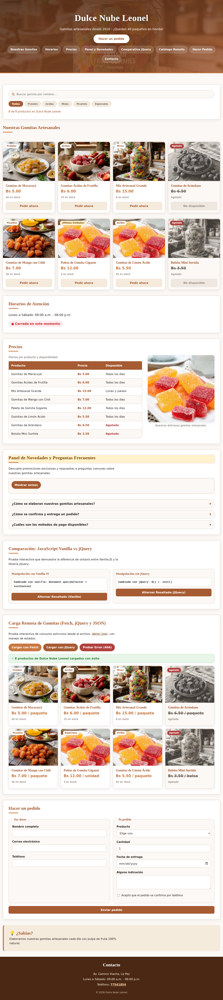
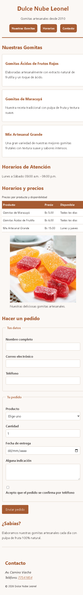

# Dulce Nube Leonel

Sitio web para presentar los productos de gomitas artesanales del negocio Dulce Nube Leonel, mostrar precios y horarios, y ayudar a los clientes a preparar sus pedidos.

**Estudiante:** Nayeli Blanco Miranda  
**Cliente:** Dulce Nube Leonel

## Laboratorio 2: Eventos y jQuery

En este laboratorio se trabajó con eventos del navegador y con la librería jQuery:

- `eventos.js`: búsqueda y filtros de productos, selección desde las tarjetas, validación del formulario y preparación del pedido para WhatsApp.
- `jquery-panel.js`: menú móvil, preguntas frecuentes desplegables y avisos animados. El botón de avisos permite mostrar y ocultar la lista.
- `jquery-comparado.js`: ejemplos que comparan la selección, modificación de contenido, eventos y clases con JavaScript Vanilla y jQuery.

El archivo `jquery-comparado.js` se conserva como material del laboratorio, pero su sección demostrativa ya no aparece en la página y el archivo no se carga desde `index.html`.

## Laboratorio 3: Módulos e interacción

Este laboratorio reúne los módulos de datos, preferencias e interacción desarrollados para el sitio:

- `funciones.js`: variables del negocio, operaciones para calcular pedidos, descuentos, impuestos, funciones, cierres y estado de atención.
- `datos.js`: catálogo de productos con precios, categorías, imágenes y existencias; también contiene ejemplos de arreglos, objetos y clases.
- `render.js`: creación y actualización de las tarjetas de productos en la página.
- `tablero.js`: catálogo para armar una canasta de hasta 12 paquetes. Actualiza cantidades y total, representa cada unidad en una bandeja visual y prepara el pedido para WhatsApp.
- `preferencias.js`: guarda el tema y el orden del catálogo en el navegador; también permite calcular la distancia aproximada al negocio y abrir indicaciones en Google Maps. Para ello se solicita permiso de ubicación.
- `remoto.js`: práctica de JSON, `fetch`, `async/await`, `$.getJSON` y promesas, con manejo de errores y datos de respaldo.
- `datos.json`: catálogo en formato JSON usado por la práctica de carga remota.

`remoto.js` y `datos.json` se conservan como parte del laboratorio. La sección de carga remota se retiró de la interfaz, por lo que `remoto.js` no se carga desde `index.html`.

## Archivos principales

- `index.html`: estructura y contenido de la página.
- `estilos.css`: diseño adaptable, tarjetas, canasta y estilos para pantallas pequeñas.
- `servidor.py` e `iniciar-servidor.bat`: servidor local para probar el sitio.
- `jquery-panel.js`: único módulo de la práctica jQuery que se carga actualmente en la página.

## Cómo ejecutar el proyecto

En Windows, se puede iniciar con doble clic en `iniciar-servidor.bat` si Python está instalado. También se puede abrir una terminal en la carpeta del proyecto y ejecutar:

```bash
python servidor.py
```

Luego se abre [http://localhost:8000](http://localhost:8000). El servidor local también facilita el uso de la geolocalización, que requiere permiso del visitante y un contexto seguro como `localhost` o HTTPS.

## Funciones visibles en la página

- Catálogo con búsqueda y filtros por categoría.
- Horarios, precios y estado de atención.
- Canasta de productos con límite de 12 paquetes, cantidades, total y confirmación por WhatsApp.
- Panel de avisos y preguntas frecuentes.
- Formulario de pedido y preferencias de tema y orden.
- Cálculo de distancia aproximada al negocio y acceso a indicaciones de Google Maps.

Las secciones de comparación Vanilla/jQuery y carga remota se ocultaron de la página; sus archivos se mantienen como material de los laboratorios.

## Capturas



