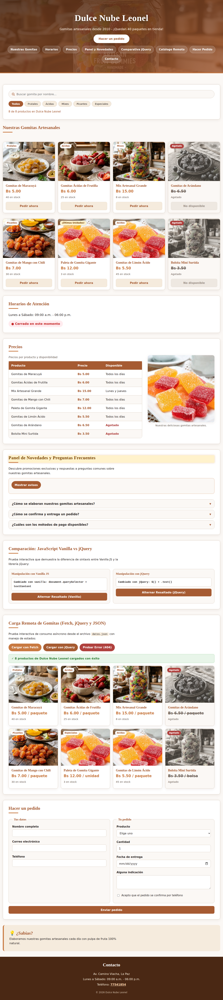
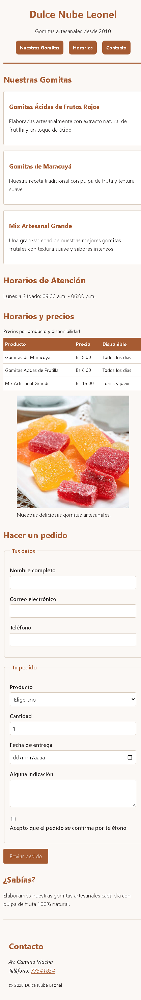

# Dulce Nube Leonel - Sitio Web Oficial

**Estudiante:** [Nayeli Blanco Miranda]
**Cliente:** Dulce Nube Leonel (Gomitas artesanales)

## Qué resuelve
El sitio web ayuda a la microempresa a mostrar sus gomitas artesanales de pulpa natural, informar sobre sus horarios de atención, publicar una tabla clara de precios y permitir que los clientes hagan sus pedidos en línea con un formulario sencillo.

## Cómo está construido
- **Semántica:** Usé etiquetas estructuradas de HTML5 como `<header>` para el título y la navegación con lista desordenada (`<ul>`, `<li>`, `<a>`), `<main>` para albergar el contenido principal, y un elemento contenedor `
` con la clase `contenido-bloque` para agrupar dinámicamente las secciones de la página. Dentro de él se encuentran `<section>` con identificadores específicos (`#nuestras-gomitas`, `#horarios`, `#precios`, `#pedido`), etiquetas `<article>` para la presentación individual de cada producto, una tabla (`<table>`, `<caption>`, `<thead>`, `<tbody>`, `<tr>`, `<th>`, `<td>`) para los precios junto con una imagen descriptiva (`<figure>`, ``, `<figcaption>`), y un formulario estructurado con `<form>`, `<fieldset>`, `<legend>`, `<label>`, distintos tipos de `<input>`, `<select>`, `<textarea>` y casillas de verificación. Se completa con un `<aside>` para el bloque informativo ("¿Sabías?") y un `<footer>` con datos de contacto (`<address>`) y derechos reservados.
- **Layout:** Usé **Flexbox** en el `<header>` y en la lista del menú (`nav ul`) para alinear y centrar los botones con `justify-content: center` y `flex-wrap: wrap`, y en los `<article>` para acomodar su contenido en columna de manera equilibrada. Usé **CSS Grid** en la sección `#productos` con `repeat(auto-fit, minmax(16rem, 1fr))` para las tarjetas de productos y en el diseño general del `body` mediante `grid-template-areas` y media queries para la distribución de los elementos.
- **Diseño:** Elegí una paleta de tonos tierra definida mediante variables CSS en `:root` (`--color-principal: #a65b32` terracota, `--color-acento: #c87941`, `--color-fondo: #fbf8f5`, entre otros) para transmitir una identidad artesanal y natural. Para las fuentes utilicé tipografías del sistema (`system-ui`) garantizando legibilidad y un rendimiento óptimo.

## Cómo ejecutarlo (importante para la carga remota)
La sección **Catálogo Remoto** usa `fetch()` y `$.getJSON()` para leer `datos.json`. Los navegadores bloquean esas peticiones cuando la página se abre con doble clic (`file://`), por eso antes "no funcionaba". Para verla funcionando de verdad hay que abrirla desde un servidor local:

1. **Windows:** doble clic en `iniciar-servidor.bat` (requiere Python instalado).
2. **Cualquier sistema:** en la carpeta del proyecto ejecutar `python servidor.py` y abrir http://localhost:8000
3. **VS Code:** clic derecho en `index.html` > *Open with Live Server*, o la configuración *Open http://localhost:8000* de `.vscode/launch.json`.

Si el sitio se abre con doble clic, el catálogo remoto muestra un aviso y carga los datos de respaldo de `datos.js` para que la sección no quede vacía.

## Mejoras de la versión profesional
- **Catálogo remoto corregido:** detecta `file://`, muestra mensajes claros y usa datos de respaldo; los estados (cargando, éxito, aviso y error 404) tienen estilo propio.
- **jQuery con respaldo local:** si el CDN no carga (sin internet), se usa `lib/jquery-3.6.0.min.js`.
- **Diseño:** portada con imagen, navegación en píldoras, tarjetas con fotos de cada producto (`img/min`, optimizadas de ~800 KB a ~80 KB), etiquetas de stock, tablas con filas alternadas y formulario en dos columnas.
- **Pedidos:** el botón "Pedir ahora" elige el producto en el formulario; al enviar se muestra el total y un enlace para confirmar por WhatsApp.
- **Detalles:** indicador "Abierto ahora / Cerrado" (hora de Bolivia), fecha mínima de entrega con hora local, enlace "Saltar al contenido", favicon y metadatos para compartir.

## Capturas

## Lo más difícil
Lo que más me costó fue hacer que el sitio se adapte bien a diferentes pantallas sin que se desordene. Al principio, cuando ponía el menú en celulares, los botones se salían o quedaban apretados, lo cual arreglé agregando `flex-wrap: wrap` y `justify-content: center` en `nav ul` para que bajen solos y queden centrados. 

También tuve un problema con la sección del `<aside>` ("¿Sabías?"), porque en pantallas grandes el CSS Grid me lo mandaba hacia un lado en una segunda columna y se veía raro, pero yo quería que se mantenga abajo después del contenido principal. Lo resolví acomodando las `grid-template-areas` dentro del `@media (min-width: 60rem)` en una sola columna vertical (`cabecera`, `principal`, `lateral`, `pie`) para que todo fluya hacia abajo en orden.